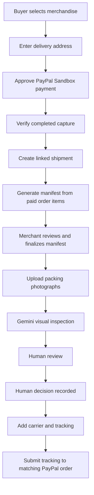
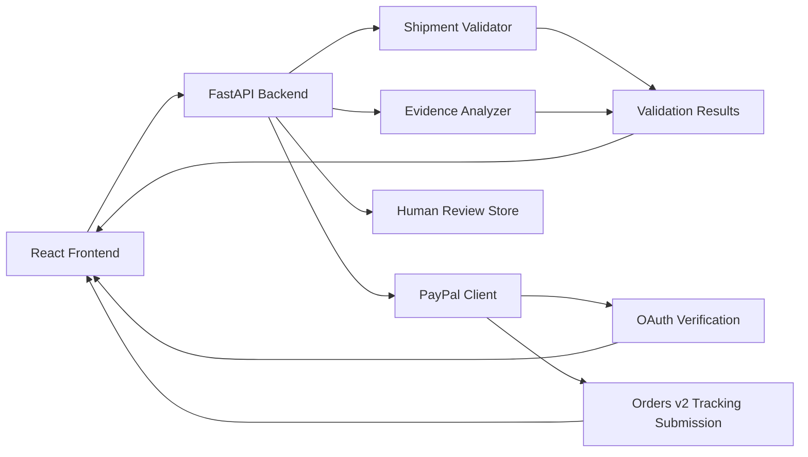

 <div align="center">

# ShipProof AI

### PayPal-Connected Order Fulfilment & Evidence

**From paid order to reviewed packing evidence and shipment tracking.**

A fulfilment workspace for online merchants that connects PayPal payments to the exact products purchased, order-derived packing manifests, AI-assisted visual inspection, human review and shipment tracking.

<br />


<br />

**Built for the PayPal AI Hackathon 2026**

</div>

---

## The problem

For small online merchants, payment details, product lists, packing checks and shipment tracking can sit in separate tools. When a buyer reports a missing or incorrect item, the merchant may have to reconstruct what was purchased, packed and shipped.

**ShipProof AI connects those steps to one paid order and shipment record.**

It provides a centralized workflow for reviewing shipment data, identifying evidence-quality issues, understanding potential risks, and preparing a PayPal tracking payload for review.

## What ShipProof AI does

| Capability | What it provides |
|---|---|
| Buyer checkout | A small storefront for physical merchandise with recipient and delivery details. |
| PayPal payment | PayPal Sandbox Orders v2 checkout with server-priced item lines and verified capture. |
| Order-derived manifest | Creates the packing manifest from the exact items and quantities in the paid order. |
| Packing inspection | Uses Gemini for visual observations while keeping the decision with a human reviewer. |
| Shipment linkage | Carries the local order, PayPal order, capture and buyer delivery details into one shipment record. |
| Evidence review | Helps merchants examine shipment data and identify evidence-quality gaps. |
| Human packing decision | Records an append-only merchant approval, rejection or correction request separately from Gemini's observations. |
| PayPal tracking submission | Sends tracking to the matching Orders v2 order and capture only after the latest inspection is approved; external writes are disabled by default. |

## How it works



## Core workflow

### 01 — Buyer checkout

The buyer selects physical merchandise, enters a recipient and delivery address, then approves the payment in PayPal Sandbox.

### 02 — Verify payment and create fulfilment records

The backend calculates the total from the active catalogue and sends the persisted item lines and delivery address to PayPal Orders v2. Only a completed capture with the expected order ID, capture ID, currency and amount is marked as paid. That paid order creates one linked shipment and a DRAFT manifest derived from the exact purchased items.

### 03 — Prepare and review the packing manifest

The merchant reviews the purchased items, quantities, SKU, item value and fragile flags. The manifest can be finalized and fingerprinted before the packing inspection begins.

### 04 — Record packing evidence

Packing staff upload photographs for Gemini visual inspection. The model reports visible observations and uncertainty; it cannot verify the contents of a sealed package or make the merchant's final decision. Every inspection remains pending human review.

### 05 — Record the human decision

A merchant records APPROVED, REJECTED or NEEDS_CORRECTION, along with a reviewer label and notes. The review history is stored separately from Gemini's AI result. A new inspection must be submitted after corrections; a reviewed inspection cannot be overwritten.

### 06 — Submit carrier tracking

For a persistent PayPal-paid shipment, the merchant enters the carrier and tracking number after the latest inspection is approved. The backend obtains the PayPal order ID, capture ID and purchased item lines from the stored checkout record; it does not trust client-supplied payment identifiers. Tracking is sent to the PayPal Orders v2 Add Tracking endpoint. The local write gate stays disabled until explicitly enabled for a Sandbox test. Evidence-quality checks are advisory and do not determine official PayPal Seller Protection eligibility.

## Technology stack

| Layer | Technology |
|---|---|
| Frontend | React, Vite, JavaScript, CSS |
| Backend | Python, FastAPI |
| Validation | Deterministic validation rules |
| Evidence analysis | Rule-based checks and NLP-style text heuristics |
| Payments integration | PayPal REST API – Sandbox |
| Testing | Python unittest, Oxlint, Vite build |

### Architecture



## Run locally

### Prerequisites

- Python 3.11 or compatible supported version.
- Node.js and npm.
- Git.

The commands below use **Command Prompt (CMD)**, including the integrated terminal in VS Code.

### 1. Clone the repository

\`\`\`cmd
git clone https://github.com/BasutkarSony/ShipProof-AI.git
cd ShipProof-AI
\`\`\`

### 2. Set up the backend

\`\`\`cmd
cd backend
python -m venv .venv
.venv\Scripts\activate.bat
python -m pip install -r requirements.txt
copy .env.example .env
\`\`\`

Open \`backend/.env\` in VS Code and add your PayPal Sandbox credentials. Keep this file private and do not commit it.

Start the backend in this terminal:

\`\`\`cmd
uvicorn app.main:app --reload --host 127.0.0.1 --port 8000
\`\`\`

Backend: \`http://127.0.0.1:8000\`

### 3. Set up the frontend

Open a **second CMD terminal** in VS Code:

\`\`\`cmd
cd frontend
npm ci
npm run dev
\`\`\`

Frontend: \`http://localhost:5173\`

### 4. Configure PayPal Sandbox

1. Create or use a PayPal Sandbox REST application.
2. Add the Sandbox Client ID and Secret to \`backend/.env\`.
3. Set \`FRONTEND_URL=http://localhost:5173\`.
4. Keep \`PAYPAL_TRACKING_SUBMISSION_ENABLED=false\` for initial testing.
5. Restart the backend after changing environment variables.

**Never commit or share your actual \`.env\` file or API credentials.**

## PayPal integration and safety

Checkout and capture use PayPal Orders v2. The tracking integration uses the matching Orders v2 endpoint:

`POST /v2/checkout/orders/{id}/track`

The backend uses the saved PayPal order ID, its completed capture ID and item lines from the paid checkout. The route rejects sample shipments, unpaid orders, unfinalized manifests and shipments whose latest packing inspection has not been approved by a human reviewer.

Tracking writes are disabled by default:

```env
PAYPAL_TRACKING_SUBMISSION_ENABLED=false
```

Keep this setting false while checking the app. For an intentional Sandbox tracking test, enable the gate locally only after confirming the buyer payment and merchant review. A successful OAuth check alone does not submit tracking.

The Orders v2 tracking API supports retrying the same capture and tracking number idempotently. Treat an uncertain network result carefully and retry with the same tracking details; do not create a different tracking update until the previous result is resolved.

Official documentation:

- [PayPal Orders v2 Add Tracking API](https://developer.paypal.com/api/tracking/track-orders/use/)
- [PayPal Supported Carriers](https://developer.paypal.com/track-orders/carriers/)

## Demo scenarios

The sample dataset contains shipment scenarios designed to demonstrate validation and evidence review.

| Order | Demonstration scenario |
|---|---|
| ORD-1001 | Standard shipment record |
| ORD-1002 | Missing tracking information |
| ORD-1003 | Delivery date earlier than shipment date |
| ORD-1004 | High-value shipment with signature-related evidence |
| ORD-1005 | High-value shipment with a signature-evidence concern |

### Suggested demonstration

1. Start the frontend and backend.
2. Open the shipment queue.
3. Run the available shipment checks.
4. Select `ORD-1002` to demonstrate missing tracking information.
5. Select `ORD-1003` to demonstrate a chronology issue.
6. Inspect `ORD-1005` to demonstrate evidence review and remediation.
7. Open AI Inspections and record a human approval, rejection or correction request.
8. For a real PayPal Sandbox checkout only, verify tracking remains blocked until the latest human approval and then demonstrate the Orders v2 tracking submission with the write gate enabled locally.

## Testing

### Backend tests

From the backend directory:

```powershell
.\.venv\Scripts\python.exe -m unittest discover -s tests -v
```

### Frontend checks

From the frontend directory:

```cmd
npx oxlint src
npm run build
```

Use the project's installed dependencies and scripts when running the checks.

## Important limitations

ShipProof AI is a hackathon prototype, not an official PayPal product.

- Current evidence analysis uses deterministic rules and text-pattern heuristics; it should not be represented as verified generative AI inference.
- Text entered by a merchant is not independent proof from a carrier.
- A readiness assessment is an advisory evidence-quality indicator, not a prediction of dispute outcomes.
- ShipProof AI cannot guarantee PayPal Seller Protection or determine PayPal's final decision.
- Carrier verification depends on the availability of an authoritative verification source.
- Sample shipment records are for demonstration and testing.
- This prototype does not implement merchant authentication or role-based access control; reviewer labels are self-entered demo labels, not verified identities.
- PayPal Sandbox authentication does not prove that tracking submission works. A real Sandbox tracking test is still required.

## Project structure

```text
ShipProof-AI/
│
├── backend/
│   ├── app/
│   │   ├── main.py
│   │   ├── ai_analyzer.py
│   │   ├── validator.py
│   │   └── paypal_client.py
│   │
│   ├── data/
│   │   └── sample_orders.json
│   │
│   ├── tests/
│   │   ├── test_ai_analyzer.py
│   │   ├── test_human_review_and_tracking.py
│   │   ├── test_paypal_checkout.py
│   │   └── test_validator.py
│   │
│   ├── requirements.txt
│   └── .env.example
│
├── frontend/
│   ├── public/
│   ├── src/
│   │   ├── main.jsx
│   │   └── style.css
│   │
│   ├── package.json
│   └── vite.config.js
│
├── .gitignore
├── README.md
└── shipproof_paypal_setup.ps1
```

## Security

Do not commit:

- `.env` files or API credentials.
- Salesforce CLI state and `.sf` metadata.
- Python virtual environments.
- `node_modules` and generated build files.
- Access tokens, private keys, or other confidential configuration.

Review `.gitignore` before publishing changes.

---

<div align="center">

### ShipProof AI

**Better shipment evidence starts with better data.**

Built for the PayPal AI Hackathon 2026.

</div>

## Repository

[GitHub Repository](https://github.com/BasutkarSony/ShipProof-AI) · [MIT License](LICENSE)
