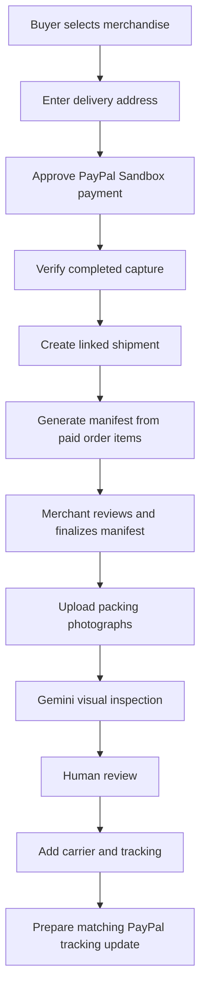
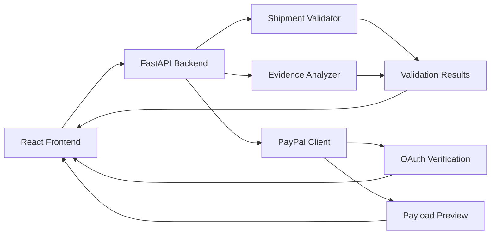

 <div align="center">

# ShipProof AI

### PayPal-Connected Order Fulfilment & Evidence

**From paid order to reviewed packing evidence and shipment tracking.**

A fulfilment workspace for online merchants that connects PayPal payments to the exact products purchased, order-derived packing manifests, AI-assisted visual inspection, human review and shipment tracking.

<br />


<br />

**Built for the PayPal AI Hackathon 2026**

</div>

---

## The problem

For small online merchants, payment details, product lists, packing checks and shipment tracking can sit in separate tools. When a buyer reports a missing or incorrect item, the merchant may have to reconstruct what was purchased, packed and shipped.

**ShipProof AI connects those steps to one paid order and shipment record.**

It provides a centralized workflow for reviewing shipment data, identifying evidence-quality issues, understanding potential risks, and preparing a PayPal tracking payload for review.

## What ShipProof AI does

| Capability | What it provides |
|---|---|
| Buyer checkout | A small storefront for physical merchandise with recipient and delivery details. |
| PayPal payment | PayPal Sandbox Orders v2 checkout with server-priced item lines and verified capture. |
| Order-derived manifest | Creates the packing manifest from the exact items and quantities in the paid order. |
| Packing inspection | Uses Gemini for visual observations while keeping the decision with a human reviewer. |
| Shipment linkage | Carries the local order, PayPal order, capture and buyer delivery details into one shipment record. |
| Evidence review | Helps merchants examine shipment data and identify evidence-quality gaps. |
| Tracking preparation | Prepares shipment tracking information with external writes disabled by default. |

## How it works



## Core workflow

### 01 — Buyer checkout

The buyer selects physical merchandise, enters a recipient and delivery address, then approves the payment in PayPal Sandbox.

### 02 — Verify payment and create fulfilment records

The backend calculates the total from the active catalogue and sends the persisted item lines and delivery address to PayPal Orders v2. Only a completed capture with the expected order ID, capture ID, currency and amount is marked as paid. That paid order creates one linked shipment and a DRAFT manifest derived from the exact purchased items.

### 03 — Prepare and review the packing manifest

The merchant reviews the purchased items, quantities, SKU, item value and fragile flags. The manifest can be finalized and fingerprinted before the packing inspection begins.

### 04 — Record packing evidence

Packing staff upload photographs for Gemini visual inspection. The model reports visible observations and uncertainty; it cannot verify the contents of a sealed package or make the merchant's final decision. Every inspection remains pending human review.

### 05 — Add shipment tracking and review evidence

The merchant records the carrier and tracking number, then reviews the associated payment, order, manifest and packing evidence. Tracking submission is a separate action and stays disabled by default. Evidence-quality checks are advisory and do not determine official PayPal Seller Protection eligibility.

## Technology stack

| Layer | Technology |
|---|---|
| Frontend | React, Vite, JavaScript, CSS |
| Backend | Python, FastAPI |
| Validation | Deterministic validation rules |
| Evidence analysis | Rule-based checks and NLP-style text heuristics |
| Payments integration | PayPal REST API – Sandbox |
| Testing | Python unittest, Oxlint, Vite build |

### Architecture



## Run locally

### Prerequisites

- Python 3.11 or compatible supported version.
- Node.js and npm.
- Git.

### 1. Clone the repository

```powershell
git clone https://github.com/BasutkarSony/ShipProof-AI.git
cd ShipProof-AI
```

Replace `BasutkarSony` with the GitHub repository owner.

### 2. Set up the backend

Open a PowerShell terminal:

```powershell
cd backend

python -m venv .venv

.\.venv\Scripts\Activate.ps1

python -m pip install -r requirements.txt
```

Start the backend:

```powershell
uvicorn app.main:app --reload --host 127.0.0.1 --port 8000
```

Backend:

`http://127.0.0.1:8000`

### 3. Set up the frontend

Open a second terminal:

```powershell
cd frontend

npm ci

npm run dev
```

Frontend:

`http://localhost:5173`

### 4. Configure PayPal Sandbox

For Sandbox connection verification:

1. Create or use a PayPal Sandbox REST application.
2. Copy `backend/.env.example` to `backend/.env`.
3. Add the required Sandbox credentials using the variable names provided in the example file.
4. Restart the backend if necessary.

**Never commit or share your actual `.env` file or API credentials.**

## PayPal integration and safety

ShipProof AI includes a PayPal Sandbox authentication-verification workflow and a tracking payload preview.

The external tracking endpoint used for payload preparation is:

`POST /v1/shipping/trackers-batch`

Tracking writes are disabled by default:

```env
PAYPAL_TRACKING_SUBMISSION_ENABLED=false
```

The safeguards distinguish between:

- Successful Sandbox OAuth authentication.
- Tracking payload preparation.
- Actual tracking submission.

Successful authentication does not mean tracking data has been submitted.

A real PayPal transaction ID is required for an actual tracking operation. Sample identifiers such as `SANDBOX-TXN-1001` are demonstration data, not valid PayPal transactions.

Official documentation:

- [PayPal Add Tracking API](https://developer.paypal.com/api/tracking/track-orders/use/)
- [PayPal Supported Carriers](https://developer.paypal.com/track-orders/carriers/)

## Demo scenarios

The sample dataset contains shipment scenarios designed to demonstrate validation and evidence review.

| Order | Demonstration scenario |
|---|---|
| ORD-1001 | Standard shipment record |
| ORD-1002 | Missing tracking information |
| ORD-1003 | Delivery date earlier than shipment date |
| ORD-1004 | High-value shipment with signature-related evidence |
| ORD-1005 | High-value shipment with a signature-evidence concern |

### Suggested demonstration

1. Start the frontend and backend.
2. Open the shipment queue.
3. Run the available shipment checks.
4. Select `ORD-1002` to demonstrate missing tracking information.
5. Select `ORD-1003` to demonstrate a chronology issue.
6. Inspect `ORD-1005` to demonstrate evidence review and remediation.
7. Review the updated findings and PayPal payload preview.
8. Show that tracking submission remains disabled.

## Testing

### Backend tests

From the backend directory:

```powershell
.\.venv\Scripts\python.exe -m unittest discover -s tests -v
```

### Frontend checks

From the frontend directory:

```powershell
npx oxlint src

npm run build
```

Use the project's installed dependencies and scripts when running the checks.

## Important limitations

ShipProof AI is a hackathon prototype, not an official PayPal product.

- Current evidence analysis uses deterministic rules and text-pattern heuristics; it should not be represented as verified generative AI inference.
- Text entered by a merchant is not independent proof from a carrier.
- A readiness assessment is an advisory evidence-quality indicator, not a prediction of dispute outcomes.
- ShipProof AI cannot guarantee PayPal Seller Protection or determine PayPal's final decision.
- Carrier verification depends on the availability of an authoritative verification source.
- Sample shipment records are for demonstration and testing.
- PayPal Sandbox authentication does not prove that tracking submission works.

## Project structure

```text
ShipProof-AI/
│
├── backend/
│   ├── app/
│   │   ├── main.py
│   │   ├── ai_analyzer.py
│   │   ├── validator.py
│   │   └── paypal_client.py
│   │
│   ├── data/
│   │   └── sample_orders.json
│   │
│   ├── tests/
│   │   ├── test_ai_analyzer.py
│   │   └── test_validator.py
│   │
│   ├── requirements.txt
│   └── .env.example
│
├── frontend/
│   ├── public/
│   ├── src/
│   │   ├── main.jsx
│   │   └── style.css
│   │
│   ├── package.json
│   └── vite.config.js
│
├── .gitignore
├── README.md
└── shipproof_paypal_setup.ps1
```

## Security

Do not commit:

- `.env` files or API credentials.
- Salesforce CLI state and `.sf` metadata.
- Python virtual environments.
- `node_modules` and generated build files.
- Access tokens, private keys, or other confidential configuration.

Review `.gitignore` before publishing changes.

---

<div align="center">

### ShipProof AI

**Better shipment evidence starts with better data.**

Built for the PayPal AI Hackathon 2026.

</div>

## Repository

[GitHub Repository](https://github.com/BasutkarSony/ShipProof-AI) · [MIT License](LICENSE)
